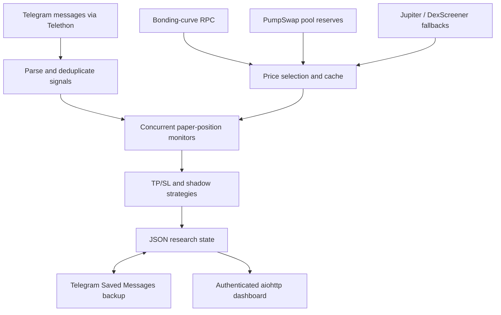

# PaperBot

**An asynchronous Python research tool for monitoring Telegram signals and simulating Solana token trades.**

PaperBot turns incoming signal messages into hypothetical positions, follows prices across bonding curves and AMM pools, and compares take-profit and stop-loss strategies. It combines event processing, HTTP integrations, binary on-chain data parsing, persistent state, and a browser dashboard in one personal project. It does not submit transactions or require a wallet private key.

## About this public version

This is the public version of my privately developed PaperBot project. The private repository contains the original development history with many commits. This repository starts with a fresh snapshot so that private history, credentials, authenticated sessions, and historical research data are not published.

The six original Python files are preserved unchanged from the supplied source snapshot, including the full trading engine and supporting tools. This is the actual implementation, not a simplified demonstration or a reconstruction. Public-release changes add documentation, configuration examples, exclusions for sensitive files, and offline checks. The existing private deployment is managed separately.

## What it does

- Listens for Telegram call cards and milestone updates through Telethon; extracts contract addresses, tickers, market caps, and bonding progress.
- Monitors simulated positions concurrently with `asyncio`, checking prices every five seconds.
- Reads Solana bonding-curve data before graduation and discovers PumpSwap pools afterward, with Jupiter and DexScreener fallbacks and a short-lived stale-price cache.
- Compares seven shadow strategies alongside the main simulated strategy.
- Saves JSON state with an atomic file replacement; supports backup and restore through the authenticated account's Telegram Saved Messages.
- Serves an `aiohttp` dashboard protected by HTTP Basic authentication: overview, active positions, and individual trade details.

The main strategy in this snapshot uses **50% take profit, 15% stop loss, a hypothetical entry of 1 SOL, and a 24-hour maximum hold**. Some older source comments describe earlier settings; the constants in `paper_trading_bot.py` control current behavior.

## Architecture



The main application is intentionally still a single large module. It keeps signal ingestion, pricing, simulation, persistence, and dashboard rendering together. This makes the original implementation easy to trace, while separation into smaller components is a clear next improvement.

| File | Responsibility |
| --- | --- |
| `paper_trading_bot.py` | Full event loop, parsing, price engine, shadow strategies, persistence, backup/restore, and dashboard |
| `CA_FORWARDER.py` | Optional standalone signal forwarder with configurable source and destination |
| `paper_report.py` | Offline analysis of locally generated trade records |
| `paper_report (1).py` | Alternate historical report variant, retained for source completeness |
| `recover_trades.py` | Standalone recovery utility that infers outcomes for open positions and rewrites local records |
| `generate_session.py` | Interactive local helper that prints a sensitive Telethon session string |
| `tests/test_paperbot.py` | Offline checks using synthetic data and mocked dashboard startup |

## Run locally

Use Python 3.12, matching `runtime.txt`. From the repository directory:

```bash
python -m venv .venv
# Windows PowerShell
.venv\Scripts\Activate.ps1
# macOS/Linux alternative: source .venv/bin/activate
python -m pip install -r requirements.txt
```

Copy `.env.example` to `.env` and fill in your own values:

| Variable | Purpose |
| --- | --- |
| `API_ID`, `API_HASH` | Your Telegram application credentials |
| `HELIUS_RPC_URL` | Your Solana RPC endpoint, including your own provider key if required |
| `DASHBOARD_PASSWORD` | Required viewer password; dashboard requests fail closed when unset |
| `SESSION_STRING` | Optional authenticated Telethon session; otherwise the bot prompts for local login |
| `PORT` | Dashboard port, default `8080` |
| `LOG_FILE` | Research state path, default `paper_trades.json` |
| `BACKUP_HOURS` | Telegram backup interval, default `6` |

The main bot's source channel is the `SOURCE` constant in `paper_trading_bot.py`; the environment variable `SOURCE` applies only to the optional forwarder. Channel access and its message format must match the parser.

```bash
python -X utf8 paper_trading_bot.py
```

Open [the local dashboard](http://localhost:8080) and sign in as `viewer` with your configured password. Routes are `/`, `/live`, and `/trade/{id}`. The raw `/json` route is not registered in this version.

The bot connects to Telegram, reads Saved Messages for backups, and writes backup files there. Use your own test account/session and isolated research files. Do not reuse a running private deployment's session for a second instance.

For optional session generation, run `python generate_session.py` locally. Its output grants account access: store it as a secret, never in a README, screenshot, or shared log. The forwarder sends messages to its configured destination, so configure it deliberately before running it.

## Offline verification

```bash
python -X utf8 -m unittest discover -s tests -v
```

These tests use synthetic inputs and do not connect to Telegram, an RPC service, or a live deployment. They cover parsing, strategy transitions, state persistence, and dashboard access control. They do not establish live API compatibility or trading accuracy.

Generate a local report after collecting your own data with `python paper_report.py`. Its constants and the recovery utility retain older 100%/20% assumptions; review them before using either to evaluate the main bot's current 50%/15% strategy. The alternate report variant has its own historical assumptions as well.

## How I used Claude

I used Claude extensively during development, including generating much of the initial architecture and implementation and helping with debugging and iterative changes. My role was defining the goals, simulation rules, and expected behavior, testing outcomes, identifying mismatches, and directing the next changes.

This project reflects an AI-assisted development process. I do not present it as entirely hand-written code. I am continuing to build my independent Python engineering skills, particularly around understanding asynchronous control flow, validating price sources, recovery behavior, and writing focused tests.

## Engineering lessons and limitations

- Token graduation changes where prices come from; a successful API request alone does not prove that a price is comparable to the entry price.
- Polling and stale caches can miss or delay price movements. Simulation results do not establish executable returns, fees, slippage, or available liquidity.
- Startup closes previously open positions as zero-P&L timeouts; backup restore and the separate recovery tool have different semantics and need stronger reconciliation.
- JSON files suit a single process; concurrent writers and multi-instance deployment need a database and stronger coordination.
- Dashboard HTML includes external message-derived values; escaping and a broader security review remain future work. Keep operational dashboards private and use HTTPS for any hosted access.
- Dependencies are currently unpinned, and external service schemas can change. Live integration behavior requires separate testing.

Next steps are to separate ingestion, pricing, strategy evaluation, and presentation; expand mocked outage/restart tests; escape dashboard fields; and align legacy reports with the simulation configuration.

See [deployment notes](DEPLOY.md), [security notes](SECURITY.md), and [public snapshot provenance](PUBLIC_RELEASE.md).
